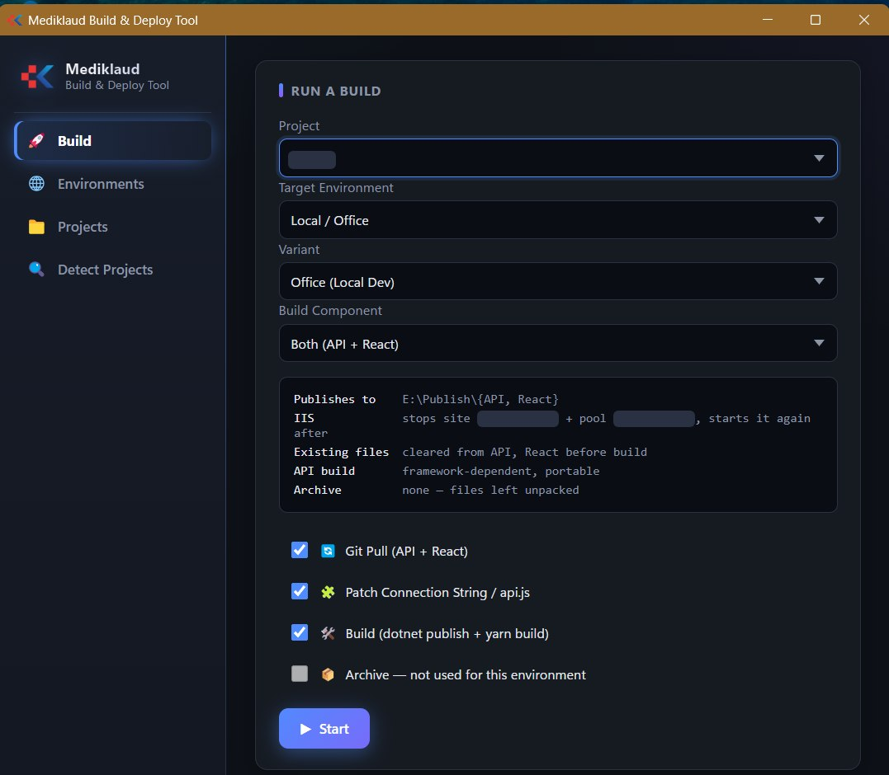

# Mediklaud Deployment Tool

A Windows desktop app (Electron) that automates build and packaging of ERP releases for 20+ client systems, replacing manual build and zip steps with a single tool.



## What it does

- **Automates the release pipeline:** `git pull` → React build → `dotnet publish` → IIS site / app pool handling → packaging into a versioned, timestamped zip, with live progress and a Stop button.
- **Detects projects automatically:** finds project folders and their current Git branch, so you can build any project without opening it in an IDE.
- **Handles multi-environment config:** switches environment-specific database connections and API URLs before a build and restores the original files afterward.
- **Flexible output:** publish the API and React build to a target folder, or package everything into a zip.

## Tech stack

- Electron 33 (main and renderer process in plain JavaScript)
- esbuild (bundles the main process)
- electron-builder (Windows NSIS installer)
- archiver (zip packaging)

## Getting started

Requirements: Windows, Node.js, Git, .NET SDK, and IIS if you use the IIS handling step.

```bash
# install dependencies
yarn install

# run the app
yarn start

# build the Windows installer (output in dist/)
yarn dist
```

(`npm install`, `npm start` and `npm run dist` work as well.)

## Notes

Built as a personal tool for my team's ERP release process. Project and environment definitions live in a local, git-ignored `config/environments.json`; start from `config/environments.example.json`.

## Author

**Aminul Islam**, Software Developer · [Portfolio](https://rd-aminul.github.io) · [LinkedIn](https://www.linkedin.com/in/aminulislam-rb/)
